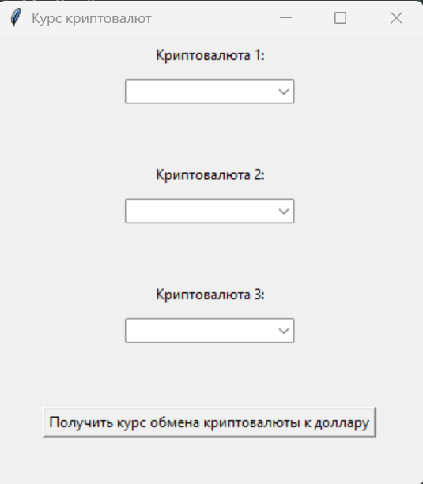
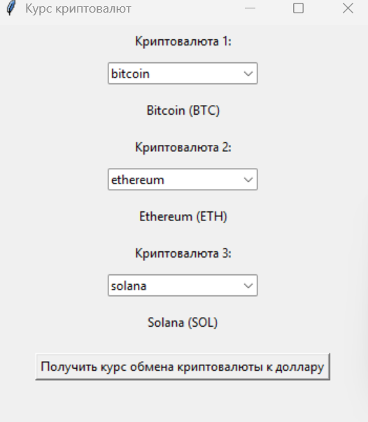
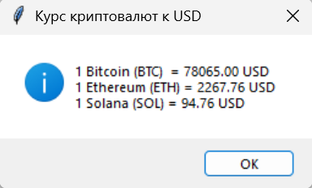

# Итоговая аттестационная работа: Приложение «Курс криптовалют»

Данный репозиторий содержит материалы итоговой проектной работы. 
Разработано приложение с графическим интерфейсом (GUI) на языке Python,
которое отображает актуальные курсы популярных криптовалют к доллару США (USD)
с использованием открытого API CoinGecko.

## 📋 Документация
Полная пояснительная записка (включая техническое задание, результаты исследования API, требования к интерфейсу, листинг программы и заключение) доступна в файле:
👉 **[Итоговая работа.pdf](Final_Work.pdf)**

## 📸 Скриншоты работы



## 🚀 Как запустить программу
1. Убедитесь, что у вас установлен Python 3.x.
2. Установите библиотеку `requests`:
   ```bash
   pip install requests
3. Запустите файл **[crypto_app.py](crypto_app.py)**.
