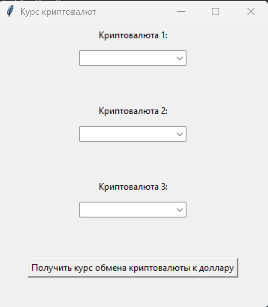
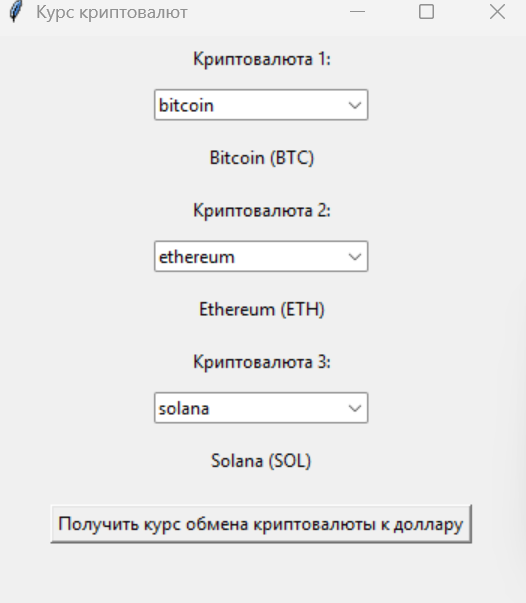
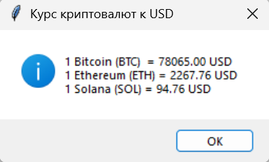

# Проект «Курс криптовалют»

Данный проект представляет собой приложение с графическим интерфейсом (GUI) на языке Python для отображения актуальных курсов популярных криптовалют по отношению к доллару США (USD). Данные берутся в реальном времени из открытого API CoinGecko.

## 📋 Техническое задание
Полное Техническое задание с оглавлением, эскизом интерфейса и требованиями доступно в файле:
👉 **[ТЗ_Курс_криптовалют.pdf](ТЗ_Курс_криптовалют.pdf)** 
## 📸 Скриншоты работы



## 🚀 Как запустить программу
1. Убедитесь, что у вас установлен Python 3.x.
2. Установите библиотеку `requests`:
   ```bash
   pip install requests
3. Запустите файл **[Задание_6_курс_криптовалют.py](Задание_6_курс_криптовалют.py)**.
